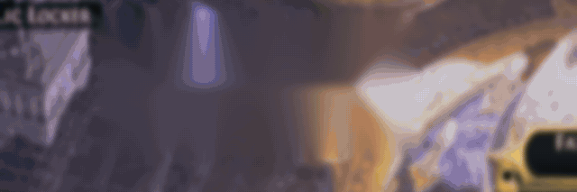
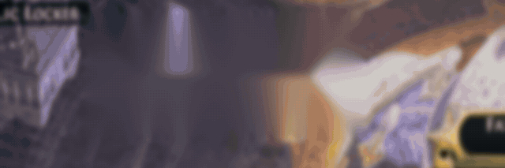
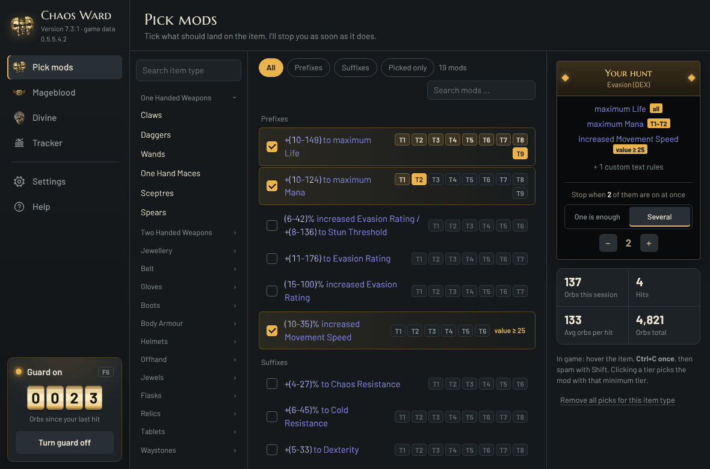
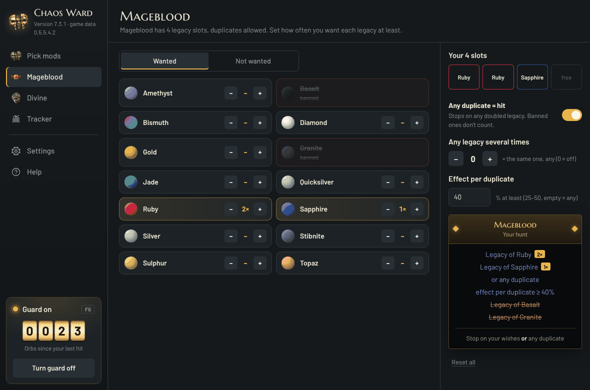
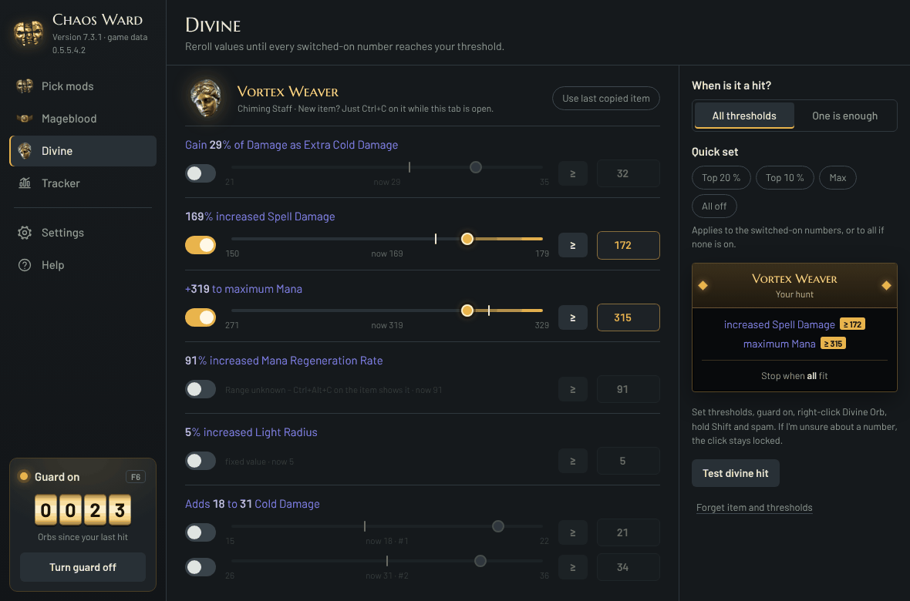
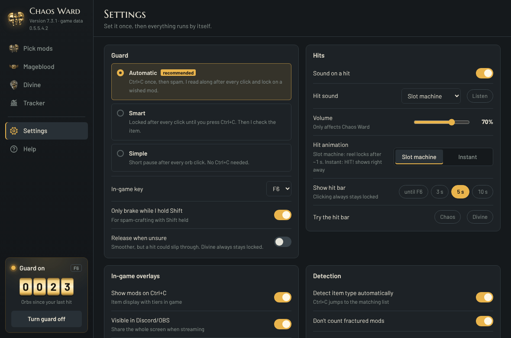

# 🛡️ Chaos Ward

[](https://ko-fi.com/chaosward)

**A crafting guard for Path of Exile 2.** Chaos Ward holds back your clicks the moment the mod you want lands on your item, so you never spam one orb too many and roll away a great craft.

> 🚫🤖 **No macro.** Chaos Ward never reads game memory, never presses keys and never clicks for you. It only reads what *you* copy with Ctrl+C and, in Automatic mode, the item tooltip on your screen. The most it ever does is hold back your own clicks.

<p align="center">
  <br>
  
</p>

📜 © 2026 moemor · Licensed under PolyForm Noncommercial 1.0.0 (see [`LICENSE.txt`](LICENSE.txt)) · Fan project, not affiliated with or endorsed by Grinding Gear Games.

## 💛 About this project

Chaos Ward is my first project. It grew out of my passion for Path of Exile.

Chaos Ward was designed, directed and tested by moemor and developed with the help of AI (Claude by Anthropic).

---

## ✨ Features

- 🎯 **Pick mods**: every mod for every item type straight from the game data, with tiers (T1 = best). Tick what you want, set a minimum tier or value, and choose whether one hit or several at once should stop you.
- 🩸 **Mageblood**: set how many of each Legacy you want (duplicates allowed), ban unwanted Legacies, or stop on *any* duplicate, with an optional minimum effect per duplicate.
- ✨ **Divine**: load an item with Ctrl+C and set a threshold for every number (e.g. "Spell Damage ≥ 172"). Chaos Ward locks as soon as all thresholds (or any one) are met.
- 🛡️ **Three guard modes**
  - ⚡ *Automatic* (recommended): press Ctrl+C once, then spam. Chaos Ward reads the tooltip after every click and locks on a hit.
  - 🧠 *Smart*: locked after every click until you press Ctrl+C.
  - ⏸️ *Simple*: a short pause after every orb click.
- 🎰 **Slot-machine hit display**: a reel spins and locks onto the mod that hit (Divine: digit reels with the values you reached), with its own sound. An *Instant* option skips the spin.
- 🔍 **In-game item display**: shows your item like the game tooltip, with tier chips and your hits in gold.
- 📊 **Tracker**: orbs since the last hit, this session, total, average per hit and a history.
- 🖥️ **Works on many setups**: multiple monitors, 1080p to 4K, ultrawide, Windows scaling, HDR and SDR. A built-in system check explains anything that doesn't fit.
- 🌍 German and English interface.

## 🖼️ Screenshots

| 🎯 Pick mods | 🩸 Mageblood |
|---|---|
|  |  |
| ✨ **Divine** | ⚙️ **Settings** |
|  |  |

<sub>The hit animations above are rendered from the real drawing code of Chaos Ward with a sample item.</sub>

## 📦 Install

1. ⬇️ Download `dist/ChaosWard-Setup-<version>.exe` and double-click it.
2. ⚠️ If Windows shows *"Windows protected your PC"*: click **More info → Run anyway** (the file is not code-signed yet).
3. ✅ Chaos Ward installs per user (no admin rights), adds a desktop and Start-menu shortcut and an entry under **Settings → Apps** for uninstalling. Updates keep your wishes and settings.

💻 **Requirements:** Windows 10/11 (64-bit) with WebView2 (built in), the game in **English** and in **windowed / windowed fullscreen** mode. Automatic mode uses Windows OCR and needs the English language pack.

## 🚀 Quick start

1. 🪟 Set the game to windowed fullscreen and English.
2. ☑️ In **Pick mods**, choose the item type and tick the mods you want (or press Ctrl+C on your item and Chaos Ward picks the type).
3. 🟢 Press **F6** in game to turn the guard on.
4. 🖱️ Hover the item, press Ctrl+C once, then right-click the orb, hold Shift and spam.
5. 🎉 On a hit the reel locks and your click is blocked. Press **F6** when you're done.

## 🔐 Privacy

* Chaos Ward sends **nothing** to the internet. No account, no tracking, no analytics.
* Everything stays on your PC in `%LOCALAPPDATA%\ChaosWard` (settings, wishes, tracker).
* Screen reading happens locally with the OCR built into Windows, only around the item tooltip.
* The only things that open a web page are the Ko-fi button and links you click yourself.
* The diagnostic package is created only when you press the button, and you decide whether to send it.

## ❓ FAQ

**Can I get banned for using it?**
Chaos Ward was built around Grinding Gear Games' rule of one server action per key press: it never sends keys or clicks, never reads or changes game memory and never injects anything into the game. It can only *block* a click you make. Like every third party tool it is used at your own risk, and GGG has not reviewed or endorsed it.

**Does it work with the game in another language?**
Not yet. The mod data only exists in English, so the game must be set to English.

**Does it work on Linux, Mac or Steam Deck?**
No, Chaos Ward is Windows only (10 and 11, 64 bit).

**Why AutoHotkey?**
It is a well known, open and lightweight way to work with mouse input on Windows. The whole program is a readable script, so anyone can check what it does.

**Will it be updated for new leagues?**
Yes, the mod data is rebuilt from the game files for every league.

## ☕ Support

Chaos Ward is free and will stay free. If it saved you a few divines, you can buy me a coffee on [Ko-fi](https://ko-fi.com/chaosward). Thank you!

## 🩹 Known issues and troubleshooting

Chaos Ward is still young and has only been tested on a few PCs so far. If something goes wrong, open **Settings → Diagnostic package → Create**. It puts a ZIP file on your desktop with everything needed to help (system check, monitors, settings and unsure readings). Please send that file along with a short description.

| Problem | What helps |
|---|---|
| ⚠️ *"Windows protected your PC"* when starting the setup | The file is not code-signed yet. Click **More info → Run anyway**. |
| 🦠 Antivirus warning | Some scanners flag AutoHotkey programs by mistake. The full source is in this repository, so you can check it yourself. |
| 🔒 Clicks are not blocked at all | The game runs as administrator, Chaos Ward doesn't. Start the game normally or use **Restart as administrator** in the system check. |
| 🖥️ Nothing shows up over the game | The game is in exclusive fullscreen. Switch to **windowed fullscreen**. |
| 🌐 Mods are not recognised | The game must be set to **English**. Other game languages are not supported yet. |
| ❓ *"Couldn't read it reliably"* | Press Ctrl+C once on the item, this checks and unlocks. After changing monitor, resolution or HDR use **Settings → Text recognition → Re-calibrate**. |
| 📝 Automatic mode reads nothing | Windows OCR needs the English language pack: **Settings → Time & language → Language → Add English (US)**, then restart. |
| ⌨️ Smart mode: Ctrl+C does nothing | Release Shift before pressing Ctrl+C. |
| 🐢 Hit animation stutters | Choose **Settings → Hit animation → Instant**. The frame time is logged in `Diagnose/leistung.txt`. |
| 🧭 Overlays in the wrong place on multi monitor setups | Fixed in 7.3 for monitors with different Windows scaling. If it still happens, use **Move in game windows** in the settings and send a diagnostic package. |
| 🆕 New mods are missing after a league start | The mod data has to be updated for each league. Update to the latest version. |
| ✨ Divine stays locked | On purpose: if a number can't be read safely, Chaos Ward never releases the click. Press Ctrl+C to check. |

## 🗂️ Repository layout

| Path | Contents |
|---|---|
| `app/` | The program: `ChaosWard.ahk` (AutoHotkey v2), UI in `app/ui/` (WebView2), mod data `Mods.tsv` |
| `dist/` | Ready-to-run installer |
| `tools/` | Static checker for the script (`check_ahk.py`), UI test, sound and ray generators, mod-database builder, OCR prototypes |
| `tools/hitsim/` | Runs the real hit-bar drawing code in a browser (AHK→JS translator + GDI+ stand-in) to render preview videos |
| `tools/setup/` | Builds the installer: a tiny Windows self-extractor without a C runtime |
| `tools/mcode/` | Source of the machine-code OCR colour filter |

## 🔧 Building the installer (Linux, clang + lld)

```sh
cd tools/setup
llvm-dlltool -m i386:x86-64 -d kernel32.def -l kernel32.lib
llvm-dlltool -m i386:x86-64 -d user32.def -l user32.lib
cp ../../app/ui/icon.ico . && llvm-rc /fo setup.res setup.rc
clang --target=x86_64-pc-windows-msvc -O2 -ffreestanding -fno-stack-protector -fno-builtin -mno-stack-arg-probe -c setup.c -o setup.obj
lld-link /subsystem:windows /entry:start /nodefaultlib /out:stub.exe setup.obj setup.res kernel32.lib user32.lib
python3 pack.py stub.exe ../../app ChaosWard-Setup.exe
```

The installer unpacks the app to a temp folder and starts `ChaosWard.exe /setup`; Chaos Ward then installs itself.

## 🙌 Contributing and feedback

Bug reports and ideas are very welcome, please use the [issue templates](../../issues/new/choose). For bugs, attach the diagnostic package from **Settings → Diagnostic package**. See [`CONTRIBUTING.md`](CONTRIBUTING.md) before opening a pull request.

## 🏷️ Name and logo

"Chaos Ward" and the Chaos Ward mask logo identify the original project by moemor. The license does not grant any rights to them: forks and modified versions must use a different name and logo and must not suggest they are the official Chaos Ward.

## 📝 Changelog

See [`CHANGELOG.md`](CHANGELOG.md).

## 🤝 Third-party components

- **AutoHotkey v2** (`app/ChaosWard.exe`, renamed `AutoHotkey64.exe`): GPL, see `app/LIZENZ-AutoHotkey.txt`
- **WebView2.ahk** by thqby and **OCR.ahk** by Descolada: MIT
- **Barlow** and **Marcellus SC** fonts: SIL Open Font License (`app/ui/fonts/`)
- Mod data derived from the Path of Exile 2 game files (via RePoE). Path of Exile is a trademark of Grinding Gear Games.
