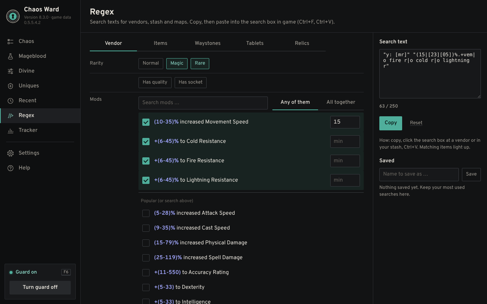
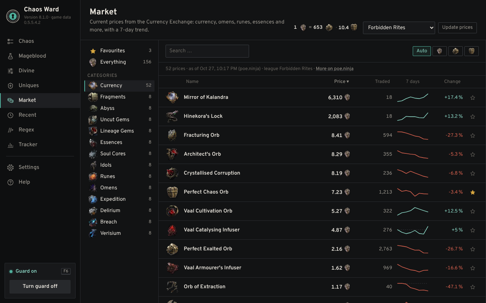

# 🛡️ Chaos Ward

**A crafting guard for Path of Exile 2.** Chaos Ward holds back your clicks the moment the mod you want lands on your item, so you never spam one orb too many and roll away a great craft.

> 🚫🤖 **No macro.** Chaos Ward never reads game memory and never clicks for you. It only reads the item copied when *you* press the guard key and, in Automatic mode, the item tooltip on your screen. The most it ever does is hold back your own clicks. The only key it ever sends is one Ctrl+C when *you* press the guard key (F6) with the mouse on an item, to copy that item (you can switch this off in the settings).

   
  

📜 © 2026 moemor · Licensed under PolyForm Noncommercial 1.0.0 (see [`LICENSE.txt`](LICENSE.txt)) · Fan project, not affiliated with or endorsed by Grinding Gear Games.

## 💛 About this project

Chaos Ward is my first project. It grew out of my passion for Path of Exile.

Chaos Ward was designed, directed and tested by moemor and developed with the help of AI (Claude by Anthropic).

---

## ✨ Features

- 🎯 **Chaos**: every mod for every item type straight from the game data, with tiers (T1 = best) and a picture of each item type. Tick what you want, set a minimum tier or value, and choose whether one hit or several at once should stop you. Rings, amulets and belts also list the Breach tree mods.
- 🩸 **Mageblood**: set how many of each Legacy you want (duplicates allowed), ban unwanted Legacies, or stop on *any* duplicate, with an optional minimum effect per duplicate. Counts your Divine Orbs.
- ✨ **Divine**: hover an item and press F6 to load it, then set a threshold for every number (e.g. "Spell Damage ≥ 172"). Desecrated and Breach tree mods included. Chaos Ward locks as soon as all thresholds (or any one) are met.
- 💎 **Uniques**: prices per league (from the poe.ninja economy API, cached in this repository), item pictures, and the corruption enchants each unique can get. Tick the enchants you want and Chaos Ward locks when one appears while you corrupt. One click opens the matching trade search (normal, corrupted or twice corrupted).
- 🔎 **Regex**: search texts for the in-game search box (vendors, stash items, waystones, tablets, relics), built from the game data. Pick mods and minimum values, copy, paste. Save your most used searches by name. In game, a click on the search magnifier or into the search box, Ctrl+F or an optional Island button shows them in a small menu: hover, click, Ctrl+V.
- 📈 **Market**: current Currency Exchange prices per league for currency, fragments, omens, runes, essences, soul cores, idols, gems, catalysts and more, with the Divine/Exalted/Chaos rate, a 7-day trend line, the change in percent, how much was traded, favourites, a search and a calculator. Prices in Divine, Exalted or Chaos (Auto picks the readable one). From the poe.ninja economy API, refreshed every hour in this repository; the page fetches the new list when it is older than 30 minutes.
- 🕘 **Recent**: the items you copied or price checked, with their mods, a trade search and a jump to the matching Chaos or Uniques page. Currency, omens and the like show their market price.
- 🛡️ **Two guard modes**
  - ⚡ *Automatic* (recommended): hover the item, press F6, then spam. Chaos Ward reads the tooltip after every click on that item and locks on a hit.
  - ⏸️ *Simple*: a short pause after every orb click.
- 🔒 **Hit display**: a seal locks in half a second and shows the mod that hit (Divine: the values you reached, Uniques: the enchant), with a matching sound. Then it stays still. An *Instant* option skips the motion. Size, opacity and accent colour are adjustable.
- 🔍 **In-game item display**: shows your item with tier marks and your hits in gold.
- 📊 **Tracker**: Chaos Orbs and Divine Orbs counted separately: since the last hit, this session, total, average per hit and a history.
- 🏝️ **Island**: a small see-through seal at the top of the game. Hover it for quick access: open Chaos Ward, switch between Auto and Pause, or toggle the guard. Never takes focus from the game.
- 🔄 **Game data updates**: new mod lists for every patch are built automatically from the game files. **Settings → Game data** shows the patch you use, checks for a new one and lets you switch between patches. If a download fails, the old patch stays active.
- 🤝 **Exiled Exchange 2**: works side by side with the price checker. Chaos Ward finds it, shows its keys, warns about key conflicts and can add items you price check to *Recent*. A setup button walks you through installing it.
- 🔐 **Item protection** (optional): turn on the key in the settings, hover a finished item and press Ctrl+Shift+P. Clicks on it are blocked from then on, so no stray orb and no accidental selling. Hold Alt to click it anyway.
- ⌨️ **Your own guard key**: F2 to F12, or record any key with Ctrl/Alt/Shift, or mouse button 3/4/5. Unneeded keys are off by default.
- 🚀 **Start with Windows** (optional), straight to the tray, and the window remembers its place.
- 🖥️ **Works on many setups**: multiple monitors, 1080p to 4K, ultrawide, Windows scaling, HDR and SDR. A built-in system check explains anything that doesn't fit.
- 🌍 German and English interface.

## 🖼️ Screenshots

| 🎯 Chaos | 🩸 Mageblood |
|---|---|
|  |  |
| ✨ **Divine** | 💎 **Uniques** |
|  |  |
| 🕘 **Recent** | 📊 **Tracker** |
|  |  |
| 🔎 **Regex** | 📈 **Market** |
|  |  |
| ⚙️ **Settings** | |
|  | |

The hit animations above are rendered from the real drawing code of Chaos Ward with a sample item. Prices in the screenshots are sample data.

## 🔑 Access (preview)

Chaos Ward is in a closed preview right now. The app only starts with a personal **access key** (it starts with `CW1.`), usually valid for a week. Ask **moemor** on Discord for a key and the installer.

The source code is not public during the preview. This repository holds the game data and prices the app downloads (`data/`) and the automation that keeps them up to date.

## 🔐 Privacy

* Chaos Ward sends **no data about you** anywhere. No account, no tracking, no analytics.
* It only *downloads* from this GitHub repository: new game data (mod lists per patch) and unique prices, when you press the update buttons, plus a quick look for a new patch on start if you leave that switched on.
* The item pictures on the Uniques page are loaded from Grinding Gear Games' own image server (web.poecdn.com), the same pictures the game's trade site shows.
* Only when you click **Load listings** on the Uniques page, Chaos Ward asks the official trade site (pathofexile.com) for the first 10 current listings of that unique: one search and one fetch, with its own User-Agent and a pause between requests.
* Everything stays on your PC in `%LOCALAPPDATA%\ChaosWard` (settings, wishes, tracker).
* Screen reading happens locally with the OCR built into Windows, only around the item tooltip and, for the Regex menu, a small strip around your click on a search box.
* Chaos Ward never opens a web page by itself, only links you click yourself.
* The diagnostic package is created only when you press the button, and you decide whether to send it.

## ❓ FAQ

**Can I get banned for using it?**
Chaos Ward was built around Grinding Gear Games' rule of one server action per key press: it never sends clicks, never reads or changes game memory and never injects anything into the game. It can only *block* a click you make. When you press the guard key it sends exactly one Ctrl+C (copying the tooltip, not a game action), like price check tools do; this can be switched off in the settings. Like every third party tool it is used at your own risk, and GGG has not reviewed or endorsed it.

**Does it work with the game in another language?**
Not yet. The mod data only exists in English, so the game must be set to English.

**Does it work on Linux, Mac or Steam Deck?**
No, Chaos Ward is Windows only (10 and 11, 64 bit).

**Why AutoHotkey?**
It is a well known, open and lightweight way to work with mouse input on Windows.

**Will it be updated for new leagues?**
Yes, without you doing anything. A GitHub Action runs every hour: it checks the game files and builds the mod list for a new patch (usually within hours of the patch), refreshes the market prices every hour and the unique prices every 6 hours, and fetches the unique prices right away when a new league appears. With **Settings → Game data → Keep everything up to date** on (default), Chaos Ward downloads, checks and uses a new mod list by itself, refreshes the prices and switches to the new league, and shows a note in the sidebar when a new version of Chaos Ward is out. It never does this while the guard is on, and while the game is in front only right after the start.

## 🗂️ What is in this repository

| Path | What it is |
|---|---|
| `data/Mods-<patch>.tsv`, `data/index.tsv` | Mod lists per patch, built from the game files ([RePoE](https://github.com/repoe-fork/poe2)) |
| `data/market/` | Currency Exchange prices per league (poe.ninja economy API), refreshed about every hour |
| `data/uniques/` | Unique prices per league with possible corruption enchants |
| `data/app.tsv` | The newest app version (the app shows a note when there is a newer one) |
| `data/access.tsv` | Revoked access keys |
| `tools/` | The scripts the GitHub Action runs to build these files |

## 🏷️ Name and logo

"Chaos Ward" and the Chaos Ward mask logo identify the original project by moemor. The license does not grant any rights to them: forks and modified versions must use a different name and logo and must not suggest they are the official Chaos Ward.

## 🤝 Third-party components

- **AutoHotkey v2** (the app's `ChaosWard.exe` is the renamed `AutoHotkey64.exe`): GPL, the license text ships with the app
- **WebView2.ahk**, **Promise.ahk** and **ComVar.ahk** by thqby (ahk2_lib) and **OCR.ahk** by Descolada: MIT, unchanged except the license header and include paths
- **WebView2Loader.dll** (ships with the app): Microsoft WebView2 SDK, original file with Microsoft's signature
- **Overpass** font: SIL Open Font License (ships with the app)
- Mod data and item-type pictures derived from the Path of Exile 2 game files (via [RePoE](https://github.com/repoe-fork/poe2)). Path of Exile is a trademark of Grinding Gear Games.
- Unique and market prices from the [poe.ninja](https://poe.ninja) economy API, fetched slowly by the GitHub Action and cached in `data/uniques/` and `data/market/`, so the app never asks poe.ninja itself.
