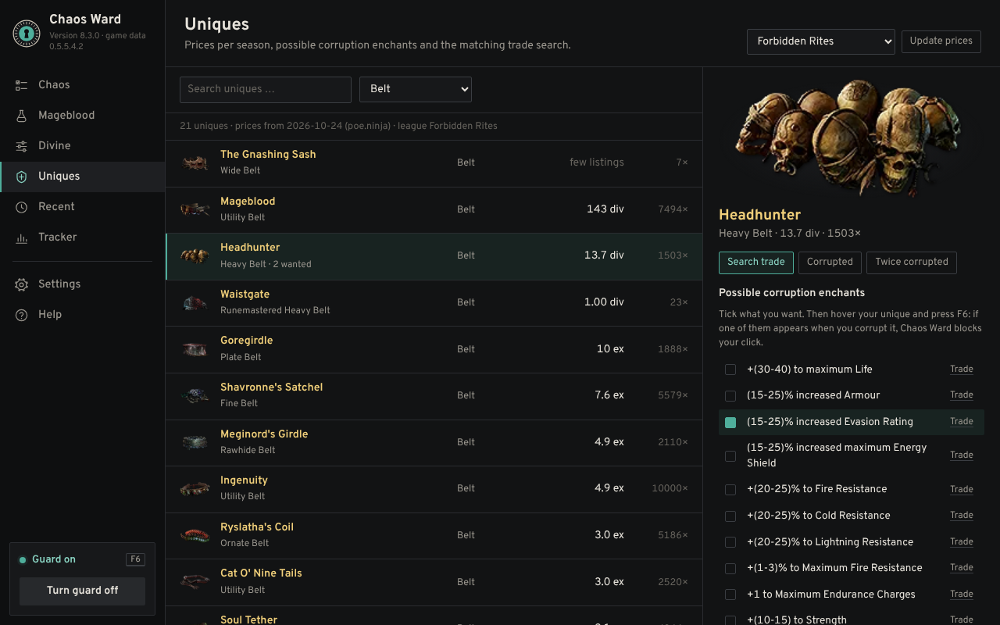
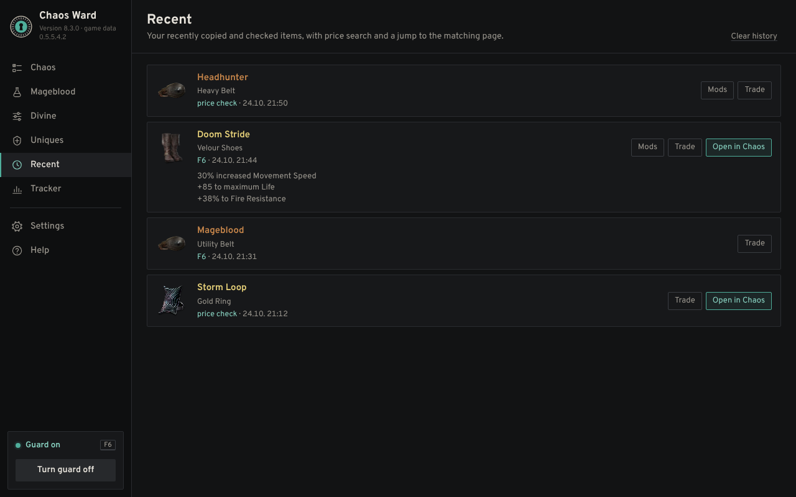
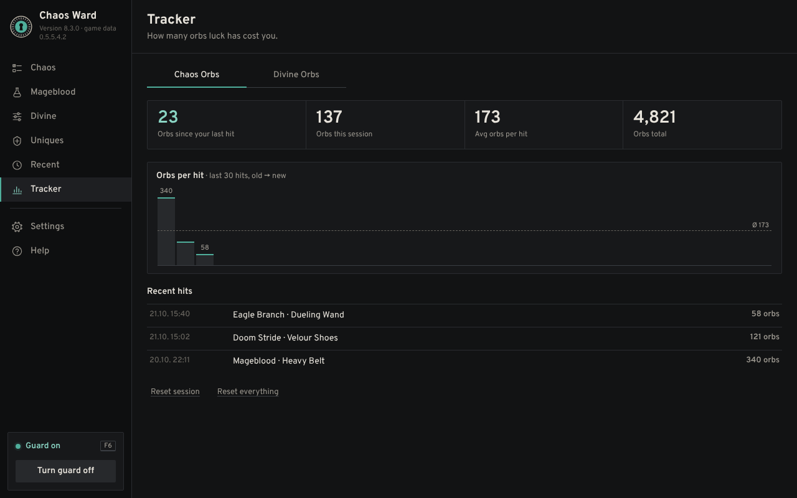

# 🛡️ Chaos Ward

**A crafting guard for Path of Exile 2.** Chaos Ward holds back your clicks the moment the mod you want lands on your item, so you never spam one orb too many and roll away a great craft.

> 🚫🤖 **No macro.** Chaos Ward never reads game memory and never clicks for you. It only reads the item copied when *you* press the guard key and, in Automatic mode, the item tooltip on your screen. The most it ever does is hold back your own clicks. The only key it ever sends is one Ctrl+C when *you* press the guard key (F6) with the mouse on an item, to copy that item (you can switch this off in the settings).

<p align="center">
  <br>
  
</p>

📜 © 2026 moemor · Licensed under PolyForm Noncommercial 1.0.0 (see [`LICENSE.txt`](LICENSE.txt)) · Fan project, not affiliated with or endorsed by Grinding Gear Games.

## 💛 About this project

Chaos Ward is my first project. It grew out of my passion for Path of Exile.

Chaos Ward was designed, directed and tested by moemor and developed with the help of AI (Claude by Anthropic).

---

## ✨ Features

- 🎯 **Chaos**: every mod for every item type straight from the game data, with tiers (T1 = best) and a picture of each item type. Tick what you want, set a minimum tier or value, and choose whether one hit or several at once should stop you.
- 🩸 **Mageblood**: set how many of each Legacy you want (duplicates allowed), ban unwanted Legacies, or stop on *any* duplicate, with an optional minimum effect per duplicate. Counts your Divine Orbs.
- ✨ **Divine**: hover an item and press F6 to load it, then set a threshold for every number (e.g. "Spell Damage ≥ 172"). Chaos Ward locks as soon as all thresholds (or any one) are met.
- 💎 **Uniques**: prices per league (from the poe.ninja economy API, cached in this repository), item pictures, and the corruption enchants each unique can get. Tick the enchants you want and Chaos Ward locks when one appears while you corrupt. One click opens the matching trade search (normal, corrupted or twice corrupted).
- 🕘 **Recent**: the items you copied or price checked, with their mods, a trade search and a jump to the matching Chaos or Uniques page.
- 🛡️ **Two guard modes**
  - ⚡ *Automatic* (recommended): hover the item, press F6, then spam. Chaos Ward reads the tooltip after every click on that item and locks on a hit.
  - ⏸️ *Simple*: a short pause after every orb click.
- 🔒 **Hit display**: a seal locks in half a second and shows the mod that hit (Divine: the values you reached, Uniques: the enchant), with a matching sound. Then it stays still. An *Instant* option skips the motion. Size, opacity and accent colour are adjustable.
- 🔍 **In-game item display**: shows your item with tier marks and your hits in gold.
- 📊 **Tracker**: Chaos Orbs and Divine Orbs counted separately: since the last hit, this session, total, average per hit and a history.
- 🏝️ **Island**: a small see-through seal at the top of the game. Hover it for quick access: open Chaos Ward, switch between Auto and Pause, or toggle the guard. Never takes focus from the game.
- 🔄 **Game data updates**: new mod lists for every patch are built automatically from the game files. **Settings → Game data** shows the patch you use, checks for a new one and lets you switch between patches. If a download fails, the old patch stays active.
- 🤝 **Exiled Exchange 2**: works side by side with the price checker. Chaos Ward finds it, shows its keys, warns about key conflicts and can add items you price check to *Recent*. A setup button walks you through installing it.
- 🔐 **Item protection** (optional): turn on the key in the settings, hover a finished item and press Ctrl+Shift+P. Clicks on it are blocked from then on, so no stray orb and no accidental selling. Hold Alt to click it anyway.
- ⌨️ **Your own guard key**: F2 to F12, or record any key with Ctrl/Alt/Shift, or mouse button 3/4/5. Unneeded keys are off by default.
- 🚀 **Start with Windows** (optional), straight to the tray, and the window remembers its place.
- 💱 **Market reader** (beta, off by default): hover the rate list in the Currency Exchange and hold Alt; Chaos Ward shows the spread, whether it trades fast, and which ratio to set for your order. You still place the order yourself.
- 🖥️ **Works on many setups**: multiple monitors, 1080p to 4K, ultrawide, Windows scaling, HDR and SDR. A built-in system check explains anything that doesn't fit.
- 🌍 German and English interface.

## 🖼️ Screenshots

| 🎯 Chaos | 🩸 Mageblood |
|---|---|
|  |  |
| ✨ **Divine** | 💎 **Uniques** |
|  |  |
| 🕘 **Recent** | 📊 **Tracker** |
|  |  |
| ⚙️ **Settings** | |
|  | |

<sub>The hit animations above are rendered from the real drawing code of Chaos Ward with a sample item. Prices in the screenshots are sample data.</sub>

## 📦 Install

1. ⬇️ Download `dist/ChaosWard-Setup-<version>.exe` and double-click it.
2. ⚠️ If Windows shows *"Windows protected your PC"*: click **More info → Run anyway** (the file is not code-signed yet).
3. ✅ Chaos Ward installs per user (no admin rights), adds a desktop and Start-menu shortcut and an entry under **Settings → Apps** for uninstalling. Updates keep your wishes and settings.

💻 **Requirements:** Windows 10/11 (64-bit) with WebView2 (built in), the game in **English** and in **windowed / windowed fullscreen** mode. Automatic mode uses Windows OCR and needs the English language pack.

## 🚀 Quick start

1. 🪟 Set the game to windowed fullscreen and English.
2. ☑️ On the **Chaos** page, choose the item type and tick the mods you want.
3. 🖱️ Hover the item and press **F6**: Chaos Ward copies the item and turns the guard on (no item under the mouse = stays off). Then right-click the orb, hold Shift and spam.
4. 🎉 On a hit the seal locks and your click is blocked. Press **F6** when you're done.

## 🔐 Privacy

* Chaos Ward sends **no data about you** anywhere. No account, no tracking, no analytics.
* It only *downloads* from this GitHub repository: new game data (mod lists per patch) and unique prices, when you press the update buttons, plus a quick look for a new patch on start if you leave that switched on.
* The item pictures on the Uniques page are loaded from Grinding Gear Games' own image server (web.poecdn.com), the same pictures the game's trade site shows.
* Everything stays on your PC in `%LOCALAPPDATA%\ChaosWard` (settings, wishes, tracker).
* Screen reading happens locally with the OCR built into Windows, only around the item tooltip.
* Chaos Ward never opens a web page by itself, only links you click yourself.
* The diagnostic package is created only when you press the button, and you decide whether to send it.

## ❓ FAQ

**Can I get banned for using it?**
Chaos Ward was built around Grinding Gear Games' rule of one server action per key press: it never sends clicks, never reads or changes game memory and never injects anything into the game. It can only *block* a click you make. When you press the guard key it sends exactly one Ctrl+C (copying the tooltip, not a game action), like price check tools do; this can be switched off in the settings. Like every third party tool it is used at your own risk, and GGG has not reviewed or endorsed it.

**Does it work with the game in another language?**
Not yet. The mod data only exists in English, so the game must be set to English.

**Does it work on Linux, Mac or Steam Deck?**
No, Chaos Ward is Windows only (10 and 11, 64 bit).

**Why AutoHotkey?**
It is a well known, open and lightweight way to work with mouse input on Windows. The whole program is a readable script, so anyone can check what it does.

**Will it be updated for new leagues?**
Yes. A GitHub Action checks the game files every 3 hours and builds the mod list for a new patch, usually within hours of the patch. In Chaos Ward press **Settings → Game data → Check for updates**, or leave the automatic check on. Unique prices are refreshed once a day.

## 🩹 Known issues and troubleshooting

Chaos Ward is still young and has only been tested on a few PCs so far. If something goes wrong, open **Settings → Diagnostic package → Create**. It puts a ZIP file on your desktop with everything needed to help (system check, monitors, settings and unsure readings). Please send that file along with a short description.

| Problem | What helps |
|---|---|
| ⚠️ *"Windows protected your PC"* when starting the setup | The file is not code-signed yet. Click **More info → Run anyway**. |
| 🦠 Antivirus warning | Some scanners flag AutoHotkey programs by mistake. The full source is in this repository, so you can check it yourself. |
| 🔒 Clicks are not blocked at all | The game runs as administrator, Chaos Ward doesn't. Start the game normally or use **Restart as administrator** in the system check. |
| 🖥️ Nothing shows up over the game | The game is in exclusive fullscreen. Switch to **windowed fullscreen**. |
| 🌐 Mods are not recognised | The game must be set to **English**. Other game languages are not supported yet. |
| ❓ *"Couldn't read it reliably"* | Hover the item and press F6 twice (off and on), this checks and unlocks. After changing monitor, resolution or HDR use **Settings → Text recognition → Re-calibrate**. |
| 📝 Automatic mode reads nothing | Windows OCR needs the English language pack: **Settings → Time & language → Language → Add English (US)**, then restart. |
| 🐢 Hit animation stutters | Choose **Settings → Hit animation → Instant**. The frame time is logged in `Diagnose/leistung.txt`. |
| 🧭 Overlays in the wrong place on multi monitor setups | Fixed in 7.3 for monitors with different Windows scaling. If it still happens, use **Move in game windows** in the settings and send a diagnostic package. |
| 🆕 New mods are missing after a league start | **Settings → Game data → Check for updates**. If no new patch is listed yet, the data is usually ready a few hours after the patch. |
| ⌨️ F6 does nothing | The mouse must be on an item inside the game window. Check that **F6 copies the item under the mouse** is on, and that no other tool (e.g. a price checker) uses F6. |
| ✨ Divine stays locked | On purpose: if a number can't be read safely, Chaos Ward never releases the click. Press F6 twice to check again. |

## 🗂️ Repository layout

| Path | Contents |
|---|---|
| `app/` | The program: `ChaosWard.ahk` (AutoHotkey v2), UI in `app/ui/` (WebView2), bundled mod data `Mods.tsv` and unique prices `Uniques.tsv` |
| `data/` | Game data per patch (`Mods-<patch>.tsv`, `index.tsv`) and unique prices per league (`uniques/`), updated by `.github/workflows/game-data.yml` |
| `dist/` | Ready-to-run installer |
| `tools/` | Static checker for the script (`check_ahk.py`), UI test, sound and ray generators, mod-database and unique-price builders, item picture extractor, OCR prototypes |
| `tools/hitsim/` | Runs the real hit-bar drawing code in a browser (AHK→JS translator + GDI+ stand-in) to render preview videos |
| `tools/setup/` | Builds the installer: a tiny Windows self-extractor without a C runtime |
| `tools/mcode/` | Source of the machine-code OCR colour filter |

## 🔧 Building the installer (Linux, clang + lld)

```sh
cd tools/setup
llvm-dlltool -m i386:x86-64 -d kernel32.def -l kernel32.lib
llvm-dlltool -m i386:x86-64 -d user32.def -l user32.lib
cp ../../app/ui/icon.ico . && llvm-rc /fo setup.res setup.rc
clang --target=x86_64-pc-windows-msvc -O2 -ffreestanding -fno-stack-protector -fno-builtin -mno-stack-arg-probe -c setup.c -o setup.obj
lld-link /subsystem:windows /entry:start /nodefaultlib /out:stub.exe setup.obj setup.res kernel32.lib user32.lib
python3 pack.py stub.exe ../../app ChaosWard-Setup.exe
```

The installer unpacks the app to a temp folder and starts `ChaosWard.exe /setup`; Chaos Ward then installs itself.

## 🙌 Contributing and feedback

Bug reports and ideas are very welcome, please use the [issue templates](../../issues/new/choose). For bugs, attach the diagnostic package from **Settings → Diagnostic package**. See [`CONTRIBUTING.md`](CONTRIBUTING.md) before opening a pull request.

## 🏷️ Name and logo

"Chaos Ward" and the Chaos Ward mask logo identify the original project by moemor. The license does not grant any rights to them: forks and modified versions must use a different name and logo and must not suggest they are the official Chaos Ward.

## 📝 Changelog

See [`CHANGELOG.md`](CHANGELOG.md).

## 🤝 Third-party components

- **AutoHotkey v2** (`app/ChaosWard.exe`, renamed `AutoHotkey64.exe`): GPL, see `app/LIZENZ-AutoHotkey.txt`
- **WebView2.ahk** by thqby and **OCR.ahk** by Descolada: MIT
- **Overpass** font: SIL Open Font License (`app/ui/fonts/`)
- Mod data and item-type pictures derived from the Path of Exile 2 game files (via [RePoE](https://github.com/repoe-fork/poe2)). Path of Exile is a trademark of Grinding Gear Games.
- Unique prices from the [poe.ninja](https://poe.ninja) economy API, fetched slowly by the GitHub Action and cached in `data/uniques/`, so the app never asks poe.ninja itself.
